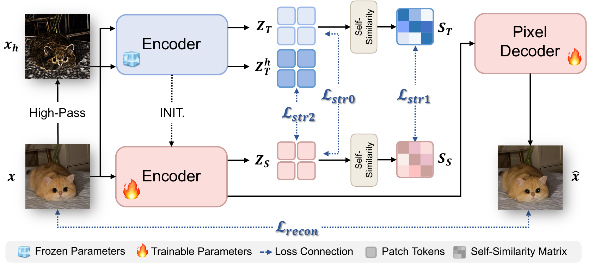
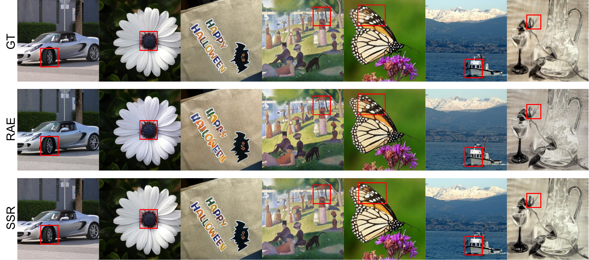

<div align="center">

<h1>One Unified Representation:<br>Resolving the Appearance-Semantics Dilemma via Structural Regularization</h1>

<p>Ruiqi Yang, Fei Zhou, Yi Zhang, Liang Li, Xiangyu Yue</p>

<p>
  <a href="#">Paper</a> &nbsp;·&nbsp;
  <a href="https://reid-yeung.github.io/SSR/">Project page</a>
</p>

</div>

## Overview

Semantic Structure Regularization (SSR) adapts a DINOv3 encoder for faithful image reconstruction while preserving the semantic structure of a frozen teacher. The resulting latents also support image generation with DiT-DH.

<p align="center"></p>

<p align="center"></p>

<p align="center"><em>Reconstruction examples: ground truth (top), RAE (middle), and SSR (bottom).</em></p>

## Code and configs

| Component | Training | Inference |
| --- | --- | --- |
| SSR autoencoder | [`configs/stage1/train.yaml`](configs/stage1/train.yaml) | [`configs/stage1/reconstruct.yaml`](configs/stage1/reconstruct.yaml) |
| DiT-DH-XL | [`configs/stage2/train_xl.yaml`](configs/stage2/train_xl.yaml) | [`configs/stage2/sample_xl.yaml`](configs/stage2/sample_xl.yaml) |
| DiT-DH-S AutoGuidance | [`configs/stage2/train_s.yaml`](configs/stage2/train_s.yaml) | [`configs/stage2/sample_xl_autoguidance.yaml`](configs/stage2/sample_xl_autoguidance.yaml) |

See [GETTING_STARTED.md](GETTING_STARTED.md) for installation, checkpoints, training, reconstruction, generation, and offline evaluation.

## Repository structure

```text
assets/                          overview figures
configs/decoder/                 ViT-XL decoder configuration
configs/stage1/                  autoencoder training and reconstruction
configs/stage2/                  DiT training and sampling
src/stage1/                      encoder, decoder, and structural objectives
src/stage2/                      DiT models and flow transport
src/disc/                        reconstruction discriminator and perceptual loss
src/eval/                        offline reconstruction metrics
src/train_stage1.py              autoencoder training
src/train.py                     DiT training
src/stage1_sample_ddp.py         reconstruction sampling
src/sample_ddp.py                image generation
src/calculate_stat.py            latent normalization statistics
src/evaluate_reconstruction.py  offline reconstruction scoring
GETTING_STARTED.md               setup and end-to-end commands
requirements.txt                 Python dependencies
```

## Citation

```bibtex
@inproceedings{yang2026ssr,
  title     = {One Unified Representation: Resolving the Appearance-Semantics Dilemma via Structural Regularization},
  author    = {Ruiqi Yang and Fei Zhou and Yi Zhang and Liang Li and Xiangyu Yue},
  booktitle = {Advances in Neural Information Processing Systems},
  year      = {2026},
  url       = {https://reid-yeung.github.io/SSR/}
}
```

## Acknowledgements

SSR builds on [Representation Autoencoders (RAE)](https://github.com/bytetriper/RAE), [DINOv3](https://github.com/facebookresearch/dinov3), and the [ADM evaluation suite](https://github.com/openai/guided-diffusion/tree/main/evaluations). We thank their authors for making these resources publicly available.

## License

SSR is released under the [MIT License](LICENSE). Original notices in upstream-derived source files are retained.
